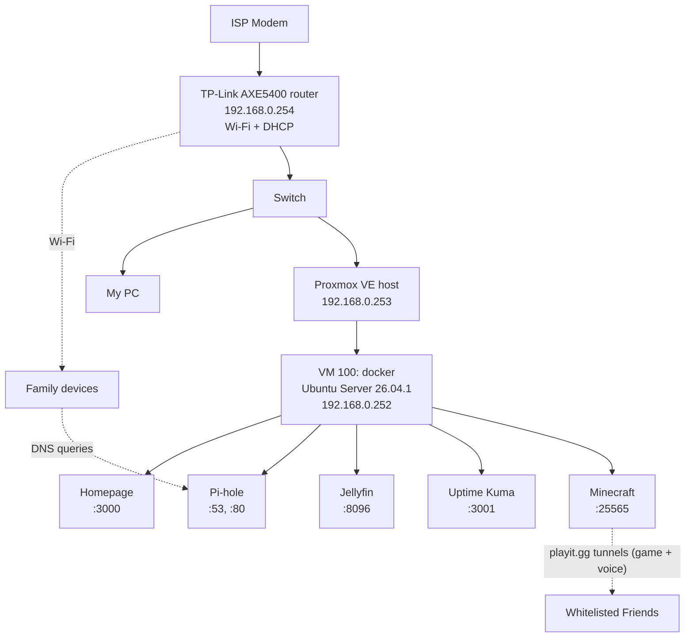

# Home Lab

A self-hosted home lab for my family's network, built to learn virtualization, containers, DNS, and (later) network security tooling. Used Claude AI for help planning, organizing, and learning how to document. I manually review documentation.

> **Status:** Phase 1 (Pi-hole + Jellyfin + Homepage + Minecraft Server) running. Uptime Kuma in progress.
> **Last updated:** 2026-11-11

---

## Goals

- **Family services:** network-wide ad blocking and a local media server everyone can use.
- **Learning:** hands-on practice with Proxmox, Docker, Linux administration, and security tooling (firewall, IDS/IPS, SIEM) that maps to my Cybersecurity and Network Management coursework.
- **Security-first:** No port forwarding, UPnP-created ports, or remote access for now. The only internet-facing service is the Minecraft server (game and voice chat), reached through playit.gg tunnels.

---

## Network Topology

---

## Current Hardware

| Component                 | Detail                                                                              |
| ------------------------- | ----------------------------------------------------------------------------------- |
| CPU                       | Intel Core i5-10400F (6C/12T, no integrated graphics)                               |
| GPU                       | NVIDIA GeForce GTX 1650 Super (planned: Jellyfin NVENC transcoding via passthrough) |
| RAM                       | 32 GB                                                                               |
| Boot SSD                  | SK hynix BC511 512 GB NVMe                                                          |
| Router                    | TP-Link AXE5400 Tri-Band Wi-Fi 6E                                                   |
| Planned NAS (not ordered) | UGREEN DXP2800 + 2x WD Red Plus (RAID 1)                                            |

---

## IP Address Plan

| Address       | Device / service | Notes                                                                       |
| ------------- | ---------------- | --------------------------------------------------------------------------- |
| 192.168.0.254 | Router           | Gateway, DHCP server                                                        |
| 192.168.0.253 | Proxmox host     | Web UI on port 8006                                                         |
| 192.168.0.252 | Docker VM        | Pi-hole, Jellyfin, Uptime Kuma, Minecraft Server, Homepage, Future Services |
| 192.168.0.251 | NAS (planned)    | Reserve when it is ordered and arrives                                      |

Static addresses sit outside the router's DHCP pool.

## Service URLs

| Service              | URL                           |
| -------------------- | ----------------------------- |
| Proxmox              | `https://192.168.0.253:8006`  |
| Pi-hole admin        | `http://192.168.0.252/admin/` |
| Jellyfin             | `http://192.168.0.252:8096`   |
| Uptime Kuma          | `http://192.168.0.252:3001`   |
| Homepage             | `http://192.168.0.252:3000`   |
| Minecraft Server     | `192.168.0.252:25565`         |
| Minecraft Voice Chat | `192.168.0.252:24454/udp`     |

---

## Documentation

| Doc                                                  | Covers                                              |
| ---------------------------------------------------- | --------------------------------------------------- |
| [01 – Proxmox](docs/01-proxmox.md)                   | Install, repositories, storage, VM settings and why |
| [02 – Docker VM](docs/02-docker-vm.md)               | Ubuntu install, media disk, Docker, port 53 fix     |
| [03 – Pi-hole](docs/03-pihole.md)                    | Deployment, testing, blocklists, rollout, rollback  |
| [04 – Jellyfin](docs/04-jellyfin.md)                 | Setup, media naming, security settings              |
| [05 – Homepage](docs/05-homepage.md)                 | Dashboard setup and config                          |
| [06 – Uptime Kuma](docs/06-uptime-kuma.md)           | In progress                                         |
| [07 – Minecraft Server](docs/07-minecraft-server.md) | Minecraft server for friends, including voice chat  |
| [Troubleshooting](docs/troubleshooting.md)           | Problems I hit and how I fixed them                 |
| [docker-compose.yml](docker/docker-compose.yml)      | Current container definitions (secrets removed)     |

---

## Roadmap (Subject to Change)

**Phase 1: Core services**
- [x] Install Proxmox VE, switch to no-subscription repo
- [x] Create Docker VM (Ubuntu Server 26.04.1)
- [x] Temporary 100 GB media disk at `/mnt/media`
- [x] Install Docker Engine + Compose
- [x] Deploy Pi-hole and Jellyfin
- [x] Roll Pi-hole out to family via router DHCP
- [x] Scheduled Proxmox VM backups
- [ ] Uptime Kuma monitoring

**Phase 1.5**
- [x] Homepage dashboard
- [ ] GPU passthrough for Jellyfin hardware transcoding (NVENC)
- [ ] Move media to NAS over NFS, remove temporary disk
- [ ] Switch Proxmox VM backups to target NAS
- [ ] Set up Homepage widgets
- [x] Minecraft server for friends (via playit.gg, no port forwarding)
- [ ] Plugins for Jellyfin

**Phase 2: Security**
- [ ] Second NIC + pfSense or OPNsense firewall (router → access point mode)
- [ ] Managed switch + VLANs (family / lab / IoT)
- [ ] Suricata IDS/IPS
- [ ] Wazuh SIEM
- [ ] Tailscale for remote access
