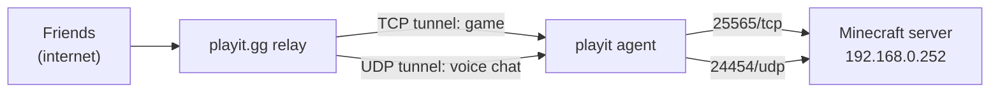

# 07 – Minecraft Server

Minecraft server for friends, reachable from Minecraft Multiplayer through a **playit.gg** tunnel instead of router port forwarding.

| LAN address       | `192.168.0.252:25565`           |
| ----------------- | ------------------------------- |
| Server software   | `Paper`                         |
| Minecraft version | `26.3`                          |
| Edition           | `Java`                          |
| Game Port         | `25565/tcp`                     |
| Voice Chat Port   | `24454/udp (Simple Voice Chat)` |

---

## Why playit.gg

- My router can't port forward, and I don't want open ports on my home network.
- playit.gg runs an **agent** on my side that makes an **outbound** connection to playit's servers. Players connect to playit's public address, and playit relays the traffic down that tunnel.
- **Tradeoff:** the server *is* internet-facing. Anyone with the address can attempt to connect, so access control (whitelist) and updates matter.



---

## Deployment

- Runs: `Docker Compose`
- Data folder: `~/homelab/minecraft`
- playit agent runs: `As a Docker container`

```yaml
minecraft:
    image: itzg/minecraft-server:latest
    container_name: minecraft
    restart: unless-stopped
    tty: true
    stdin_open: true
    ports:
      - "25565:25565"
      - "24454:24454/udp"
    volumes: ["./minecraft:/data"]
    environment:
      EULA: "TRUE"
      TYPE: PAPER
      MEMORY: ${MC_MEMORY}
      TZ: ${TZ}
      ENABLE_WHITELIST: "TRUE"
      ENFORCE_WHITELIST: "TRUE"
      WHITELIST: ${MC_WHITELIST}
      OPS: ${MC_OPS}
      MODRINTH_PROJECTS:  |
        simple-voice-chat
        chunky
```

## Simple Voice Chat 
- Installed through `MODRINTH_PROJECTS` (`simple-voice-chat`) as a Paper plugin. 
- Uses its own **UDP** port, `24454`, separate from the game port. 
- playit.gg has a **second tunnel** (UDP) pointing to `192.168.0.252:24454`. 
- The UDP tunnel gets its own public address and port, different from the game tunnel. Clients are told where to connect via `voice_host` in `minecraft/plugins/voicechat/voicechat-server.properties`:
	```properties 
	port=24454 
	voice_host=<playit UDP address>:<playit UDP port> 
	``` 
- Without `voice_host`, clients try the game address on port 24454, which doesn't exist through playit, and voice chat fails to connect. 
- Restart after changing: `docker restart minecraft`.
### Resources

| Setting                | Value |
| ---------------------- | ----- |
| Memory given to server | `8GB` |
| View distance          | `10`  |
| Max players            | `20`  |

> The Docker VM has 16 GB total, shared with Jellyfin, Pi-hole, Homepage, and Uptime Kuma. If the server lags or the VM runs out of memory, RAM can be increased as the Proxmox Server has 32 GB. Otherwise, another method will have to be found if I want to keep the server running simultaneously.

---

## Security

- [x] **Whitelist enabled** (`white-list=true`, `enforce-whitelist=true` in `server.properties`), so only approved players can join
- [x] **online-mode=true**, so players must own a real Minecraft account (prevents name impersonation)
- [x] RCON disabled, or not exposed through the tunnel
- [x] Only two ports are tunneled: 25565/tcp (game) and 24454/udp (voice chat).
- [x] Server kept updated

### Managing players

```bash
# From the server console (e.g. docker attach / rcon-cli), or in-game as op:
whitelist add <player>
whitelist remove <player>
op <player>
```

Approved players: `In whitelist.json`

---

## Backups


- World folder: `<~homelab/minecraft/world>`
- Method: `Proxmox VM backup`
- Note: Stop or `save-off` the server before copying the world manually to avoid corruption.

---

## Monitoring

> Uptime Kuma can't directly check UDP ports, so voice chat isn't monitored. If players report voice issues, check `docker logs minecraft` for voice chat errors and confirm the UDP tunnel is up in the playit.gg dashboard.

- [ ] Uptime Kuma: TCP port monitor on `192.168.0.252:25565`

---
